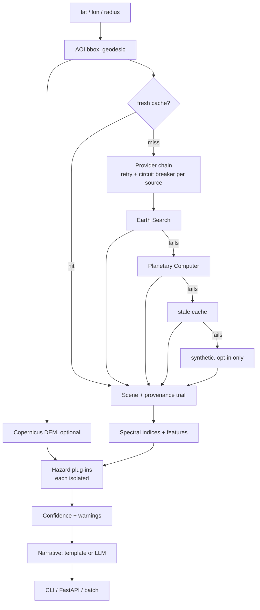

# georisk-agent

**Live demo: https://georisk-agent.vercel.app** (click the map; real Sentinel-2 imagery, ~3 s per site)

Satellite-derived **physical-risk screening** for a point of interest: pulls a recent, low-cloud
Sentinel-2 scene, computes spectral indices, scores flood / wildfire-fuel / urban-density exposure
with **explainable factors**, and (optionally) has an LLM write a short summary strictly from the
computed numbers.

It is a compact, honest GeoAI pipeline: real imagery in, transparent scoring out, no black box.



## Design: independent parts that fail alone

Every external dependency and every hazard sits behind its own boundary, so a failure degrades the
answer instead of destroying it — and the response *says* what degraded.

| If this fails... | ...this happens | Visible in output |
|---|---|---|
| Earth Search is down | Retries, then Planetary Computer serves the scene | `provenance.imagery_trail`, confidence -0.05 |
| Both imagery sources are down | Expired cache entry is served | `meta.cache = "stale"`, confidence -0.15 |
| Everything is down and no cache | HTTP 503 with the full per-source trail (or synthetic data only if `GEORISK_ALLOW_SYNTHETIC=1`, always flagged, confidence 0) | `error`, `trail` |
| A source keeps failing | Circuit opens: later requests skip it instantly, half-open after cooldown | `/health/deep` shows circuit state |
| DEM / terrain unavailable | Flood and wildfire score from imagery only | hazard `status: degraded`, confidence -0.10, warning |
| One hazard raises | That hazard is `failed`; the others still score | hazard `status: failed`, warning |
| A cache file is corrupt | Discarded and refetched, never fatal | logged |
| LLM unavailable / no key | Deterministic template narrative | `narrative_source: template` |
| One location in a batch fails | Only that item is marked failed | per-item `ok` flag |

Other guarantees: GDAL is isolated from the host (public buckets are read unsigned, so local AWS
credentials cannot break a read; every read has timeouts and bounded retries), cache writes are
atomic, and liveness (`/health`) never touches an external service.

## Quick start

```bash
docker build -t georisk-agent . && docker run -p 8000:8000 georisk-agent   # or:
pip install -e ".[dev]"

# live imagery (no API key needed)
georisk --lat 39.9612 --lon -82.9988 --radius 800 --no-llm

# fully offline, deterministic synthetic scene
georisk --lat 34.0 --lon -118.5 --offline wildland_urban --no-llm

# service
uvicorn georisk.api:app --reload      # POST /assess, GET /health
```

Optional LLM narrative: `pip install -e ".[llm]"` and set `ANTHROPIC_API_KEY`. The model is only
given the computed scores and factors and is instructed not to invent anything; if the key or call
fails, a deterministic template is used, so the service never depends on an LLM.

## Example output (live: real scenes and real elevation)

| Location | Scene | Flood | Wildfire | Urban | Overall | Confidence |
|---|---|---|---|---|---|---|
| Columbus, OH | 2026-09-25 | 12 | 23 | 22 | 28 moderate | 1.00 |
| Houston, TX | 2026-08-30 | 14 | 39 | 41 | 49 moderate | 0.85 |
| Griffith Park, CA (341 m relief, 18 deg mean slope) | 2026-09-29 | 0 | 32 | 1 | 32 moderate | 1.00 |
| Chatsworth, CA (valley floor) | 2026-09-29 | 19 | 34 | 19 | 40 moderate | 1.00 |

800 m half-side AOI, 128x128 imagery grid, ~2 s per assessment (band reads run concurrently).

## Validation against real public data

Labels are public ground truth, not synthetic: **FEMA National Flood Hazard Layer** (Special Flood Hazard
Area) for flood and **USGS/NIFC WFIGS** historical fire perimeters (>=100 acres, 2005-2018) for wildfire.
Each label is joined to Sentinel-2 imagery + Copernicus DEM features for the same point
(`python -m georisk.validation.run`, then `python -m georisk.validation.calibrate`).

Everything below is **leave-region-out**: the model is trained on every region except one and scored on
the held-out region, so it is judged on places it has never seen. AUC 0.5 = coin flip.

**Flood** (876 points, 448 in an SFHA, 16 US regions incl. six Ohio cities)

| Model | AUC | 95% CI | Brier (baseline 0.250) |
|---|---|---|---|
| Original hand-tuned heuristic | 0.607 | 0.57–0.64 | n/a |
| Logistic regression | 0.829 | 0.80–0.86 | 0.169 |
| Bagged random forest (numpy) | 0.806 | 0.78–0.83 | 0.189 |
| k-nearest neighbours | 0.786 | 0.75–0.82 | 0.195 |
| Average of logistic + forest + kNN | 0.828 | 0.80–0.85 | 0.173 |
| Random forest (scikit-learn-trained, exported to numpy) | 0.829 | 0.80–0.85 | 0.190 |
| Blend: logistic + scikit-learn forest **(served)** | 0.844 | 0.81–0.87 | 0.172 |

**Ohio case study** (Columbus, Cincinnati, Cleveland, Dayton, Toledo, Akron; 292 points). Trained on
*non-Ohio* regions only, tested in Ohio: blend model AUC **0.821**
(0.77–0.87); logistic 0.803, forest 0.727, kNN 0.732.
The original heuristic scored **0.519** there (no better than chance).
Growing the flood set from 401 to 876 points lowered every number a little (the served blend went from
0.863 to 0.844, Ohio from 0.857 to 0.821): the smaller sample was optimistic, so treat these as the
reliable figures.

**Wildfire** (292 points, 149 inside a perimeter; western US only)

| Model | AUC | 95% CI | Brier (baseline 0.250) |
|---|---|---|---|
| Original hand-tuned heuristic | 0.576 | 0.51–0.64 | n/a |
| Logistic regression | 0.742 | 0.69–0.80 | 0.202 |
| Bagged random forest (numpy) | 0.754 | 0.70–0.81 | 0.201 |
| k-nearest neighbours | 0.750 | 0.69–0.80 | 0.205 |
| Average of logistic + forest + kNN | 0.763 | 0.71–0.82 | 0.193 |
| Random forest (scikit-learn-trained, exported to numpy) **(served)** | 0.784 | 0.73–0.84 | 0.200 |
| Blend: logistic + scikit-learn forest | 0.774 | 0.72–0.83 | 0.193 |

Growing the fire set from 98 to 292 points also lowered the numbers (the previous best, kNN, went from 0.799 to
0.750) and changed which model wins, which is what a small, noisy sample does.

How to read this honestly:
- The original heuristic scores were **statistically indistinguishable from chance** against ground truth.
  That is why the service also returns a *calibrated probability* from a fitted model, and warns when a
  hazard's heuristic score has no validated model at the site's location.
- The served model for each task is whichever candidate has the best leave-region-out AUC. The candidate
  set was fixed in advance with no per-model hyper-parameter search, but with a few hundred samples the top
  candidates' intervals overlap, so the choice is not a proven win over the runner-up. A wider
  scikit-learn benchmark (`python -m georisk.validation.benchmark`: gradient boosting, extra trees, SVM)
  showed the same picture on the 876-point flood set: every model lands between 0.81 and 0.84 AUC, inside each other's confidence intervals.
- Serving needs **numpy only**: scikit-learn (the `research` extra) trains the forest, which is exported to
  plain JSON trees. PyTorch was deliberately not used: with ~10^2-10^3 tabular rows a neural net does not
  beat tree ensembles, and it would break the serverless size limit.
- A model ships only if leave-region-out AUC >= 0.6, its CI lower bound > 0.5 and Brier beats the base rate.
- **Skill is modest, not deployment-grade for insurance or lending decisions.** Weak regions: flood in
  New Orleans (AUC 0.54, pumped/leveed terrain) and Miami (0.62); fire in
  central Arizona (0.57) and the Oregon Cascades (0.67).
- Labels have known noise: FEMA maps lag the ground, fire perimeters are coarse, and the fire label
  asks "has burned before", which is a proxy for exposure, not a forecast.
- Fire probabilities are **withheld outside the western US** (the training domain) instead of
  extrapolating; flood is served across the sampled US range.

## Does a satellite foundation model help? (experiment)

I tested IBM/NASA's **Prithvi-EO-1.0-100M** (a 100-million-parameter model pre-trained on satellite imagery; Apache-2.0) against
the lightweight models above, under the same leave-region-out rules. For each labelled site I fetched a 6-band, 224 x 224
Sentinel-2 chip (30 m pixels, about 6.7 km square), ran Prithvi's encoder, and used the 768-number embedding (PCA-reduced inside each
training fold, so nothing leaks from the held-out region) on its own and combined with the tabular features. Code: `src/georisk/foundation/`.

**Flood** (863 sites)

| Model | AUC | 95% CI | Brier |
|---|---|---|---|
| features: blend (logistic + forest) | 0.848 | 0.82–0.88 | 0.169 |
| features: logistic | 0.834 | 0.81–0.87 | 0.166 |
| features: forest | 0.833 | 0.81–0.86 | 0.189 |
| average: feature blend + prithvi logistic | 0.808 | 0.78–0.84 | 0.189 |
| features + prithvi PCA16: forest | 0.801 | 0.77–0.83 | 0.206 |
| features + prithvi PCA16: logistic | 0.798 | 0.77–0.83 | 0.183 |
| prithvi only: forest on PCA32 | 0.668 | 0.64–0.70 | 0.235 |
| prithvi only: logistic on PCA32 | 0.661 | 0.62–0.70 | 0.237 |

Ohio holdout (trained on other states): feature blend 0.833, Prithvi alone 0.624, features + Prithvi 0.785.

**Wildfire** (286 sites)

| Model | AUC | 95% CI | Brier |
|---|---|---|---|
| average: feature blend + prithvi logistic | 0.780 | 0.72–0.83 | 0.190 |
| features + prithvi PCA16: forest | 0.778 | 0.71–0.83 | 0.205 |
| features + prithvi PCA16: logistic | 0.774 | 0.71–0.82 | 0.191 |
| features: forest | 0.771 | 0.70–0.83 | 0.204 |
| features: blend (logistic + forest) | 0.764 | 0.69–0.82 | 0.197 |
| features: logistic | 0.733 | 0.66–0.79 | 0.205 |
| prithvi only: logistic on PCA32 | 0.714 | 0.65–0.77 | 0.220 |
| prithvi only: forest on PCA32 | 0.714 | 0.65–0.77 | 0.226 |

**Result: the big model does not earn its cost here.**
- For flood, Prithvi alone is far worse (0.66 vs 0.85), and adding it to the tabular features *lowers* accuracy. Flood-zone status depends on fine
  terrain and water detail that a 30 m, 6.7 km chip blurs away.
- For wildfire, the best combination is marginally higher (0.780 vs 0.764), but the confidence intervals overlap almost completely, so it is a tie.
- Cost: 443 MB of weights, PyTorch, and about 1 s per chip on a laptop GPU, versus milliseconds and numpy only for the served models. It also cannot run on the free serverless deployment.
- Caveats: one encoder, one image date per chip, mean-pooled embeddings and no fine-tuning. A fine-tuned model or finer-resolution input might do better; this measures the cheap "frozen embedding" route.

So the served models stay the small ones. This is the same answer DeepSeek/Qwen-style work keeps pointing to: a small, well-matched model beats a big general one when the task is narrow and the data is clean.

## Can you trust the probabilities? (calibration audit)

Ranking sites correctly (AUC) is not the same as being honest about *how likely*. I checked, on held-out regions, what actually
happened to sites at each predicted probability. The averaged models were **compressed toward 50%**: when flood said about 26%,
only 11% of those sites were really in a flood zone; when it said 65%, 81% were (expected calibration error 0.099 flood, 0.124 fire).

- **Fix:** a two-parameter correction (Platt scaling) fitted on held-out predictions, evaluated by correcting each region using only the
  *other* regions. Flood: calibration error 0.099 -> **0.021** and Brier 0.1717 -> 0.1628, so it ships.
  Fire: error 0.124 -> 0.087 but Brier 0.2002 -> 0.2027 (slightly worse), so it does **not** ship; a correction must improve both.
- **Track record shown with every probability.** For each prediction the API (`evidence`) and the demo show what happened to similar held-out
  sites, with a 95% Wilson interval, e.g. "22% of 120 sites scored 20-30% were actually in a flood zone (16-31%)".

Flood (shown probability vs what happened in held-out regions):

| Predicted band | Sites | Actually positive | 95% range |
|---|---|---|---|
| 0–20% | 179 | 11% | 7–17% |
| 20–30% | 120 | 22% | 16–31% |
| 30–40% | 79 | 35% | 26–46% |
| 40–50% | 77 | 53% | 42–64% |
| 50–60% | 56 | 57% | 44–69% |
| 60–70% | 67 | 66% | 54–76% |
| 70–80% | 86 | 81% | 72–88% |
| 80–90% | 77 | 87% | 78–93% |
| 90–100% | 135 | 88% | 82–93% |

Wildfire (not recalibrated, so this table is the honest reading of the raw score):

| Predicted band | Sites | Actually positive | 95% range |
|---|---|---|---|
| 0–40% | 87 | 15% | 9–24% |
| 40–50% | 50 | 48% | 35–62% |
| 50–60% | 67 | 66% | 54–76% |
| 60–100% | 88 | 77% | 68–85% |

A check that did *not* pan out, and so was not built: I tested whether "this site looks unlike the training data" predicts worse accuracy.
It does not; unusual sites (extreme terrain, obvious rivers) were predicted *better*, and the hard cases are ordinary mid-range sites.
So there is no "unusual site" warning; the evidence table above is the uncertainty signal that the data supports.

## What is implemented

- Geodesic AOI construction; validated inputs.
- **Failover imagery chain** (Earth Search -> Planetary Computer) with retries, per-provider circuit
  breakers, atomic disk cache with stale-if-error, opt-in synthetic last resort.
- Windowed COG reads (a 1 km box costs a few hundred KB), SCL cloud/shadow/cirrus/snow masking,
  processing-baseline offset handling.
- **Terrain**: Copernicus 30 m DEM, mosaicked across tile boundaries, median-filtered, giving slope
  and relative elevation that modulate flood and wildfire scores.
- Spectral indices (NDVI, NDWI, NDBI, NBR) with safe division and masked statistics.
- **Pluggable hazards** (flood, wildfire, urban density), each isolated, each returning its factors.
- **Confidence score** with explicit reasons (cloud, staleness, missing terrain, fallback used).
- FastAPI: `/assess`, `/assess/batch` (per-item isolation, bounded), `/health`, `/health/deep`.
- Dockerfile with a liveness healthcheck; configuration via environment variables.
- **Calibrated probabilities** (`calibrated` field) from numpy-only models (logistic, bagged forest, kNN) fitted on FEMA/WFIGS labels; withheld outside their training domain.
- **Median compositing** (`composite=N`) of the N clearest scenes, with failover and single-scene degradation.
- **Hardened API**: optional `X-API-Key` (`GEORISK_API_KEY`), per-client rate limit (`GEORISK_RATE_PER_MIN`; per instance, so best-effort on serverless), bounded in-flight work (`GEORISK_MAX_INFLIGHT`, 429 when saturated), security headers, strict input validation without echoing raw input, no internal error text in responses, LLM narrative off unless `GEORISK_ALLOW_LLM=1`, CSP on the demo page.
- **Observability**: structured JSON logs with request IDs (no coordinates or IPs), Prometheus-format `/metrics` with bounded labels.
- **Area mode** (`POST /assess/area`, or the Area button in the demo): send a GeoJSON outline, it is cut into tiles (default 1 km, up to 16), each tile is assessed independently and in parallel, and the result is a GeoJSON FeatureCollection with a summary (mean / highest tile / tiles above 50%). A failed tile greys out only itself. Rate limit is charged per tile; outlines over 400 km² are refused.
- **Analyst memo**: every assessment includes a plain-English risk note (headline probabilities, what drives them, suggested use, imagery date, warnings) built only from the assessment's numbers. An optional LLM rewrite (`use_llm` + `GEORISK_ALLOW_LLM=1`) is accepted only if every number it writes appears in the facts it was given; otherwise the template is used.
- **Live demo** at `/`: click-to-assess satellite map. Leads with the validated probabilities and shows which factors drive them (what-if effect of each factor versus a typical training site); the unvalidated heuristic index is collapsed and labelled.


- 136 offline tests (fault injection, API security, rate limiting, metrics, calibration, model round-trips) + live smoke tests.

## Deploying (Vercel)

`vercel deploy --prod` works as-is: `app.py` is the entrypoint and `vercel.json` sets a 60 s function limit.
Vercel's Python runtime lacks `libexpat`, which rasterio's GDAL needs, so `vendor/libexpat.so.1` (unmodified
Ubuntu build, MIT) is bundled and preloaded on Linux. Set `GEORISK_API_KEY` in the project settings to require
`X-API-Key`; the per-client rate limit is per instance, so treat it as best-effort on serverless.

## Known limitations (read before trusting a score)

- The 0-100 **scores are still hand-set screening heuristics** (validated as near-chance, see above).
  Use the `calibrated` probability where present, and treat it as modest-skill screening, not a loss estimate.
- Wildfire is inferred from vegetation amount, vegetation dryness (NBR) and slope. It ignores climate,
  fuel type, wind and fuel moisture ground truth. Treat it as a *fuel-condition* signal, not fire
  probability.
- Flood exposure uses open-water and impervious-surface share from a single date. It now uses elevation and slope, but still has **no
  hydrology, drainage network or return-period data**, so it cannot tell you a parcel is in a
  regulated floodplain.
- 10–20 m pixels: cannot resolve individual buildings or defensible space.
- The Copernicus DEM is a *surface* model (buildings and canopy included). A 3x3 median removes
  single-pixel spikes, but dense high-rise areas still read rougher than the bare ground beneath.
- One scene, not a time series: seasonal effects (dormancy, snow, irrigation) are not modelled.

## Roadmap (not implemented)

- Hydrology-aware terrain features (HAND, flow accumulation) for flood context.
- Fine-tune a foundation model (Prithvi/Clay) end to end, and try finer-resolution input; the frozen-embedding route tested above did not help.
- Larger label sets (more regions, MTBS burn severity), a spatial-block CV with more Ohio-specific hydrology, and probability recalibration (isotonic) once n > 1000.

## Project layout

```
src/georisk/
  aoi.py        geodesic bounding box
  providers/    base contract, earth_search, planetary, synthetic, cache, chain (failover)
  resilience.py retry + circuit breaker
  terrain.py    DEM -> slope / relative elevation
  hazards/      flood, wildfire, urban plug-ins + isolated runner
  confidence.py trust score with reasons
  config.py     environment-driven settings
  indices.py    NDVI / NDWI / NDBI / NBR
  scoring.py    scene -> features
  synthetic.py  deterministic offline scenes
  agent.py      orchestration + optional LLM narrative
  api.py        FastAPI
  cli.py        command line
tests/
```

## License

MIT
