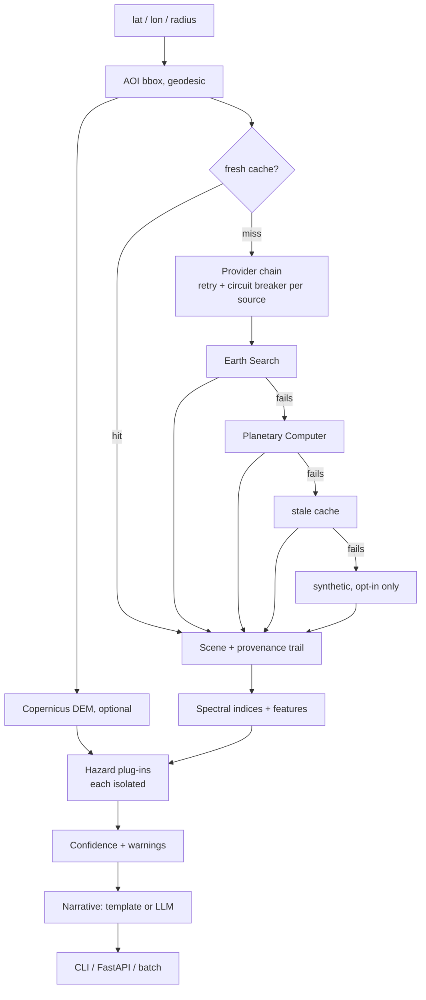

# georisk-agent

Satellite-derived **physical-risk screening** for a point of interest: pulls a recent, low-cloud
Sentinel-2 scene, computes spectral indices, scores flood / wildfire-fuel / urban-density exposure
with **explainable factors**, and (optionally) has an LLM write a short summary strictly from the
computed numbers.

It is a compact, honest GeoAI pipeline: real imagery in, transparent scoring out, no black box.



## Design: independent parts that fail alone

Every external dependency and every hazard sits behind its own boundary, so a failure degrades the
answer instead of destroying it — and the response *says* what degraded.

| If this fails... | ...this happens | Visible in output |
|---|---|---|
| Earth Search is down | Retries, then Planetary Computer serves the scene | `provenance.imagery_trail`, confidence -0.05 |
| Both imagery sources are down | Expired cache entry is served | `meta.cache = "stale"`, confidence -0.15 |
| Everything is down and no cache | HTTP 503 with the full per-source trail (or synthetic data only if `GEORISK_ALLOW_SYNTHETIC=1`, always flagged, confidence 0) | `error`, `trail` |
| A source keeps failing | Circuit opens: later requests skip it instantly, half-open after cooldown | `/health/deep` shows circuit state |
| DEM / terrain unavailable | Flood and wildfire score from imagery only | hazard `status: degraded`, confidence -0.10, warning |
| One hazard raises | That hazard is `failed`; the others still score | hazard `status: failed`, warning |
| A cache file is corrupt | Discarded and refetched, never fatal | logged |
| LLM unavailable / no key | Deterministic template narrative | `narrative_source: template` |
| One location in a batch fails | Only that item is marked failed | per-item `ok` flag |

Other guarantees: GDAL is isolated from the host (public buckets are read unsigned, so local AWS
credentials cannot break a read; every read has timeouts and bounded retries), cache writes are
atomic, and liveness (`/health`) never touches an external service.

## Quick start

```bash
docker build -t georisk-agent . && docker run -p 8000:8000 georisk-agent   # or:
pip install -e ".[dev]"

# live imagery (no API key needed)
georisk --lat 39.9612 --lon -82.9988 --radius 800 --no-llm

# fully offline, deterministic synthetic scene
georisk --lat 34.0 --lon -118.5 --offline wildland_urban --no-llm

# service
uvicorn georisk.api:app --reload      # POST /assess, GET /health
```

Optional LLM narrative: `pip install -e ".[llm]"` and set `ANTHROPIC_API_KEY`. The model is only
given the computed scores and factors and is instructed not to invent anything; if the key or call
fails, a deterministic template is used, so the service never depends on an LLM.

## Example output (live: real scenes and real elevation)

| Location | Scene | Flood | Wildfire | Urban | Overall | Confidence |
|---|---|---|---|---|---|---|
| Columbus, OH | 2026-09-25 | 12 | 23 | 22 | 28 moderate | 1.00 |
| Houston, TX | 2026-08-30 | 14 | 39 | 41 | 49 moderate | 0.85 |
| Griffith Park, CA (341 m relief, 18 deg mean slope) | 2026-09-29 | 0 | 32 | 1 | 32 moderate | 1.00 |
| Chatsworth, CA (valley floor) | 2026-09-29 | 19 | 34 | 19 | 40 moderate | 1.00 |

800 m half-side AOI, 128x128 imagery grid, ~2 s per assessment (band reads run concurrently).

## What is implemented

- Geodesic AOI construction; validated inputs.
- **Failover imagery chain** (Earth Search -> Planetary Computer) with retries, per-provider circuit
  breakers, atomic disk cache with stale-if-error, opt-in synthetic last resort.
- Windowed COG reads (a 1 km box costs a few hundred KB), SCL cloud/shadow/cirrus/snow masking,
  processing-baseline offset handling.
- **Terrain**: Copernicus 30 m DEM, mosaicked across tile boundaries, median-filtered, giving slope
  and relative elevation that modulate flood and wildfire scores.
- Spectral indices (NDVI, NDWI, NDBI, NBR) with safe division and masked statistics.
- **Pluggable hazards** (flood, wildfire, urban density), each isolated, each returning its factors.
- **Confidence score** with explicit reasons (cloud, staleness, missing terrain, fallback used).
- FastAPI: `/assess`, `/assess/batch` (per-item isolation, bounded), `/health`, `/health/deep`.
- Dockerfile with a liveness healthcheck; configuration via environment variables.
- 56 offline tests (including fault injection for every row in the table above) + live smoke tests.

## Known limitations (read before trusting a score)

- **Scores are uncalibrated screening heuristics**, not probabilities or loss estimates. Thresholds
  are hand-set and have not been fitted against labelled hazard data.
- Wildfire is inferred from vegetation amount, vegetation dryness (NBR) and slope. It ignores climate,
  fuel type, wind and fuel moisture ground truth. Treat it as a *fuel-condition* signal, not fire
  probability.
- Flood exposure uses open-water and impervious-surface share from a single date. It now uses elevation and slope, but still has **no
  hydrology, drainage network or return-period data**, so it cannot tell you a parcel is in a
  regulated floodplain.
- 10–20 m pixels: cannot resolve individual buildings or defensible space.
- The Copernicus DEM is a *surface* model (buildings and canopy included). A 3x3 median removes
  single-pixel spikes, but dense high-rise areas still read rougher than the bare ground beneath.
- One scene, not a time series: seasonal effects (dormancy, snow, irrigation) are not modelled.

## Roadmap (not implemented)

- Time-series compositing to remove seasonality.
- Hydrology-aware terrain features (HAND, flow accumulation) for flood context.
- Swap the index heuristics for a learned head on a geospatial foundation-model backbone
  (e.g. Prithvi or Clay via TorchGeo), evaluated against labelled hazard footprints.
- Calibration against public hazard layers (FEMA NFHL, MTBS burn perimeters).

## Project layout

```
src/georisk/
  aoi.py        geodesic bounding box
  providers/    base contract, earth_search, planetary, synthetic, cache, chain (failover)
  resilience.py retry + circuit breaker
  terrain.py    DEM -> slope / relative elevation
  hazards/      flood, wildfire, urban plug-ins + isolated runner
  confidence.py trust score with reasons
  config.py     environment-driven settings
  indices.py    NDVI / NDWI / NDBI / NBR
  scoring.py    scene -> features
  synthetic.py  deterministic offline scenes
  agent.py      orchestration + optional LLM narrative
  api.py        FastAPI
  cli.py        command line
tests/
```

## License

MIT
