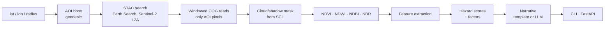

# georisk-agent

Satellite-derived **physical-risk screening** for a point of interest: pulls a recent, low-cloud
Sentinel-2 scene, computes spectral indices, scores flood / wildfire-fuel / urban-density exposure
with **explainable factors**, and (optionally) has an LLM write a short summary strictly from the
computed numbers.

It is a compact, honest GeoAI pipeline: real imagery in, transparent scoring out, no black box.



## Quick start

```bash
pip install -e ".[dev]"

# live imagery (no API key needed)
georisk --lat 39.9612 --lon -82.9988 --radius 800 --no-llm

# fully offline, deterministic synthetic scene
georisk --lat 34.0 --lon -118.5 --offline wildland_urban --no-llm

# service
uvicorn georisk.api:app --reload      # POST /assess, GET /health
```

Optional LLM narrative: `pip install -e ".[llm]"` and set `ANTHROPIC_API_KEY`. The model is only
given the computed scores and factors and is instructed not to invent anything; if the key or call
fails, a deterministic template is used, so the service never depends on an LLM.

## Example output (live, real scenes)

| Location | Scene date | Cloud | Flood | Wildfire fuel | Urban density | Overall |
|---|---|---|---|---|---|---|
| Columbus, OH | 2026-09-25 | 3% | 7 | 24 | 22 | 28 (moderate) |
| Houston, TX | 2026-08-30 | 3% | 14 | 50 | 41 | 58 (high) |
| Santa Susana Mtns, CA | 2026-09-29 | 0% | 6 | 37 | 19 | 41 (moderate) |

800 m half-side AOI (2.56 km²), 128×128 grid, 100% usable pixels in all three.

## What is actually implemented

- Geodesic AOI construction (`pyproj.Geod`), validated inputs.
- STAC search + **windowed COG reads** — a 1 km box costs a few hundred KB, not a 100 km tile.
- Surface-reflectance scaling incl. the 2022 processing-baseline offset; SCL-based cloud, shadow,
  cirrus and snow masking.
- Spectral indices (NDVI, NDWI, NDBI, NBR) with safe division and masked statistics.
- Explainable hazard scoring: every score returns the factors that produced it.
- Deterministic synthetic scenes (4 archetypes) so CI and demos run without network.
- 21 tests (20 offline + 1 live smoke test); CI on Python 3.11 / 3.12.

## Known limitations (read before trusting a score)

- **Scores are uncalibrated screening heuristics**, not probabilities or loss estimates. Thresholds
  are hand-set and have not been fitted against labelled hazard data.
- Wildfire "dry fuel" is inferred from NDVI/NBR only. It ignores climate, slope, fuel type and wind,
  so a humid city late in summer can still score moderate-to-high (see Houston above). Treat it as a
  *fuel-condition* signal, not fire probability.
- Flood exposure uses open-water and impervious-surface share from a single date. It has **no
  elevation, hydrology, or return-period data**; it cannot tell you a parcel is in a floodplain.
- 10–20 m pixels: cannot resolve individual buildings or defensible space.
- One scene, not a time series: seasonal effects (dormancy, snow, irrigation) are not modelled.

## Roadmap (not implemented)

- Time-series compositing to remove seasonality.
- DEM-derived terrain features (HAND / slope) for flood and fire-spread context.
- Swap the index heuristics for a learned head on a geospatial foundation-model backbone
  (e.g. Prithvi or Clay via TorchGeo), evaluated against labelled hazard footprints.
- Calibration against public hazard layers (FEMA NFHL, MTBS burn perimeters).

## Project layout

```
src/georisk/
  aoi.py        geodesic bounding box
  stac.py       Earth Search search + windowed reads + masking
  indices.py    NDVI / NDWI / NDBI / NBR
  scoring.py    features -> explainable hazard scores
  synthetic.py  deterministic offline scenes
  agent.py      orchestration + optional LLM narrative
  api.py        FastAPI
  cli.py        command line
tests/
```

## License

MIT
