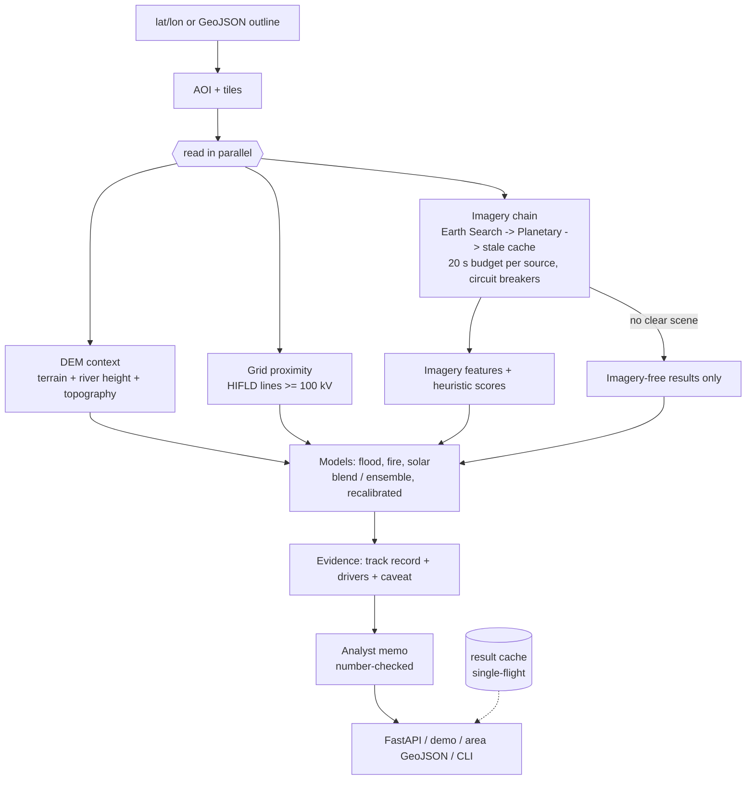
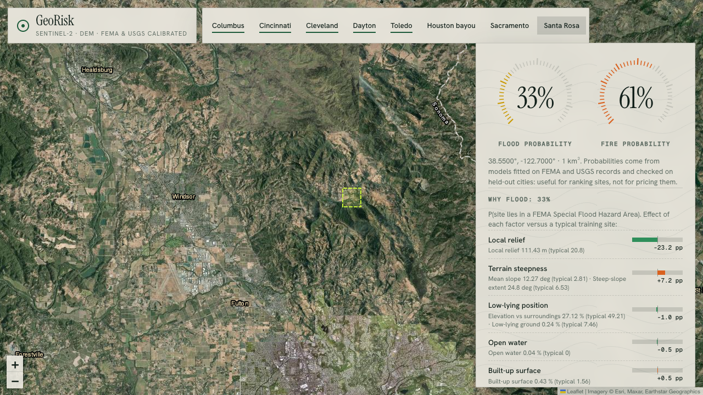
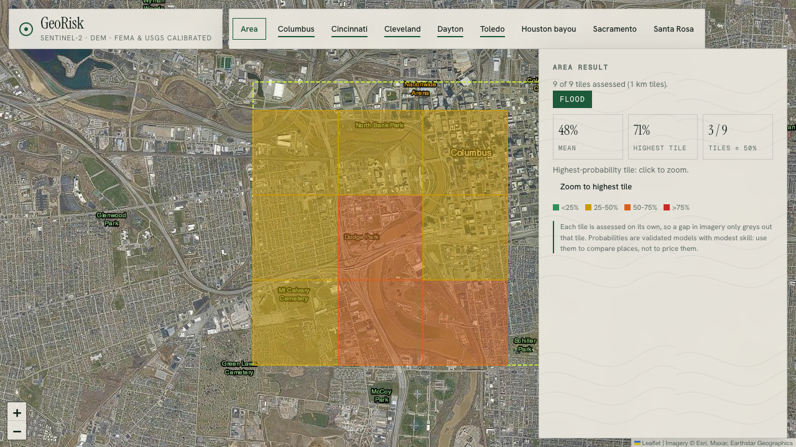

# georisk-agent

**Live demo: https://georisk-agent.vercel.app** (click the map; real Sentinel-2 imagery, ~3 s per site)

Satellite-derived **physical-risk screening** for a US site or outline: pulls a recent Sentinel-2 scene, the Copernicus elevation model and
the high-voltage grid map; returns **calibrated flood and wildfire probabilities with their track record and the factors that drive them**, an
**experimental solar-siting energy lens**, and a plain-English analyst memo built only from the numbers.

It is a compact, honest GeoAI system: every number is validated on held-out places against public records (FEMA, USGS), weaknesses are
written next to the result, and each part fails alone.



## Design: independent parts that fail alone

Every external dependency and every hazard sits behind its own boundary, so a failure degrades the
answer instead of destroying it — and the response *says* what degraded.

| If this fails... | ...this happens | Visible in output |
|---|---|---|
| Earth Search is down | Retries, then Planetary Computer serves the scene | `provenance.imagery_trail`, confidence -0.05 |
| Both imagery sources are down | Expired cache entry is served | `meta.cache = "stale"`, confidence -0.15 |
| Everything is down and no cache | HTTP 503 with the full per-source trail (or synthetic data only if `GEORISK_ALLOW_SYNTHETIC=1`, always flagged, confidence 0) | `error`, `trail` |
| A source keeps failing | Circuit opens: later requests skip it instantly, half-open after cooldown | `/health/deep` shows circuit state |
| DEM / terrain unavailable | Flood and wildfire score from imagery only | hazard `status: degraded`, confidence -0.10, warning |
| River-height (DEM context) read fails | Flood probability uses typical values for it | warning: river-height data unavailable |
| No clear satellite scene (e.g. weeks of cloud) | Results that need no imagery (solar) are returned; flood and fire are withheld | warning: imagery unavailable, `provenance.imagery: false`, confidence low |
| Grid service is down | Solar is withheld, not guessed from a median | warning: grid unavailable |
| An imagery source hangs | After a 20 s budget (`GEORISK_PROVIDER_BUDGET_S`) it stops retrying and fails over | `provenance.imagery_trail` |
| One hazard raises | That hazard is `failed`; the others still score | hazard `status: failed`, warning |
| A cache file is corrupt | Discarded and refetched, never fatal | logged |
| LLM unavailable / no key | Deterministic template narrative | `narrative_source: template` |
| One location in a batch fails | Only that item is marked failed | per-item `ok` flag |

Other guarantees: GDAL is isolated from the host (public buckets are read unsigned, so local AWS
credentials cannot break a read; every read has timeouts and bounded retries), cache writes are
atomic, and liveness (`/health`) never touches an external service.

## Quick start

```bash
docker build -t georisk-agent . && docker run -p 8000:8000 georisk-agent   # or:
pip install -e ".[dev]"

# live imagery (no API key needed)
georisk --lat 39.9612 --lon -82.9988 --radius 800 --no-llm

# fully offline, deterministic synthetic scene
georisk --lat 34.0 --lon -118.5 --offline wildland_urban --no-llm

# service
uvicorn georisk.api:app --reload      # POST /assess, GET /health
```

Optional LLM narrative: `pip install -e ".[llm]"` and set `ANTHROPIC_API_KEY`. The model is only
given the computed scores and factors and is instructed not to invent anything; if the key or call
fails, a deterministic template is used, so the service never depends on an LLM.

## Example output (live: real scenes and real elevation)

| Location | Scene | Flood | Wildfire | Urban | Overall | Confidence |
|---|---|---|---|---|---|---|
| Columbus, OH | 2026-09-25 | 12 | 23 | 22 | 28 moderate | 1.00 |
| Houston, TX | 2026-08-30 | 14 | 39 | 41 | 49 moderate | 0.85 |
| Griffith Park, CA (341 m relief, 18 deg mean slope) | 2026-09-29 | 0 | 32 | 1 | 32 moderate | 1.00 |
| Chatsworth, CA (valley floor) | 2026-09-29 | 19 | 34 | 19 | 40 moderate | 1.00 |

800 m half-side AOI, 128x128 imagery grid, ~2 s per assessment (band reads run concurrently).

## Validation against real public data

Labels are public ground truth, not synthetic: **FEMA National Flood Hazard Layer** (Special Flood Hazard
Area) for flood and **USGS/NIFC WFIGS** historical fire perimeters (>=100 acres, 2005-2018) for wildfire.
Each label is joined to Sentinel-2 imagery + Copernicus DEM features for the same point
(`python -m georisk.validation.run`, then `python -m georisk.validation.calibrate`).

Everything below is **leave-region-out**: the model is trained on every region except one and scored on
the held-out region, so it is judged on places it has never seen. AUC 0.5 = coin flip.

**Flood** (876 points, 448 in an SFHA, 16 US regions incl. six Ohio cities; 14 features: imagery, terrain and river height)

| Model | AUC | 95% CI | Brier (baseline 0.250) |
|---|---|---|---|
| Original hand-tuned heuristic | 0.607 | 0.57–0.64 | n/a |
| Logistic regression (inputs capped at 2 SD) | 0.859 | 0.84–0.88 | 0.152 |
| Bagged random forest (numpy) | 0.821 | 0.79–0.85 | 0.178 |
| k-nearest neighbours | 0.800 | 0.77–0.83 | 0.186 |
| Average of logistic + forest + kNN | 0.850 | 0.83–0.87 | 0.159 |
| Random forest (scikit-learn-trained, exported to numpy) | 0.852 | 0.82–0.88 | 0.183 |
| Blend: logistic + scikit-learn forest **(served)** | 0.866 | 0.84–0.89 | 0.158 |

**Ohio case study** (Columbus, Cincinnati, Cleveland, Dayton, Toledo, Akron; 292 points). Trained on
*non-Ohio* regions only, tested in Ohio: blend model AUC **0.856** (0.81–0.90); logistic 0.851, forest 0.764, kNN 0.768.
The original heuristic scored **0.519** there (no better than chance).

**What moved the flood numbers, in order (held-out regions):** the heuristic scored ~0.58; fitted models on imagery + terrain
0.845; **river-height features (hydrology) 0.856** (Ohio holdout 0.821 -> 0.854, the biggest single gain); **capping extreme
inputs for the linear member 0.866** (it extrapolated badly on steep sites). Each step was kept only because it improved held-out regions.

### River height (hydrology)

Flood zones are river phenomena, so `src/georisk/hydrology.py` derives them from the same free 30 m elevation data: fill pits, route
water downhill (D8), accumulate flow, mark streams (>= 0.09 km2 upstream), and compute **HAND**, the height above the nearest drainage, plus
distance to and size of the stream the site drains to. Pure numpy; about 0.1 s of compute per site (the network read dominates).
Verified on synthetic landscapes with known answers (a V-valley's HAND equals its wall height; pits are filled; accumulation counts cells exactly).
Spot check against FEMA: the Houston bayou site went from 43% to 73% (it is in a flood zone); the Scioto River site scores 84% (in one).

**Known miss:** a steep chaparral hillside east of Santa Rosa, CA scores 88% but FEMA says it is outside a flood zone. In training, steep
sites that sit near a sizeable stream are often canyon-bottom flood zones; this site resembles them. Held-out accuracy in that probability band is about 85%,
so roughly one in seven such predictions is wrong, which is exactly what the track-record table below says.

Weakest regions for flood (the served model, held out): New Orleans (0.54), Toledo (0.58), Miami (0.68). The API, memo and demo warn automatically for sites in these regions.

**Wildfire** (292 points, 149 inside a perimeter; western US only; 13 features incl. topography)

| Model | AUC | 95% CI | Brier (baseline 0.250) |
|---|---|---|---|
| Original hand-tuned heuristic | 0.576 | 0.51–0.64 | n/a |
| Logistic regression (inputs capped at 2 SD) | 0.762 | 0.71–0.82 | 0.198 |
| Bagged random forest (numpy) | 0.736 | 0.68–0.80 | 0.204 |
| k-nearest neighbours | 0.758 | 0.70–0.81 | 0.205 |
| Average of logistic + forest + kNN **(served)** | 0.777 | 0.72–0.83 | 0.190 |
| Random forest (scikit-learn-trained, exported to numpy) | 0.781 | 0.73–0.83 | 0.202 |
| Blend: logistic + scikit-learn forest | 0.780 | 0.73–0.83 | 0.191 |

Topography from the same elevation window (elevation, ridge/valley position, roughness, and whether the slope faces south) made the fire
probabilities better behaved rather than ranking much better: raw calibration error fell from 0.124 to 0.065 and Brier from 0.200 to 0.190,
with AUC about the same (0.78). Weakest regions (also warned automatically at serving time): central Arizona (0.58), the Oregon Cascades (0.66), the Colorado Front Range (0.67). Known miss: a site inside the 2018 Camp Fire
perimeter (Paradise, CA) scores only 36%; the label is "has burned before", so this is a screening signal, not a forecast.

**Which model serves.** The product is a probability, so among candidates whose AUC is within 0.01 of the best (a ranking tie), the served model is the one
with the best Brier score after the recalibration gate (flood: blend; fire: ensemble). Selection rule, scores and the recalibration decision are in `validation_data/report.json`.

How to read this honestly:
- The original heuristic scores were **statistically indistinguishable from chance** against ground truth.
  That is why the service also returns a *calibrated probability* from a fitted model, and warns when a
  hazard's heuristic score has no validated model at the site's location.
- The served model for each task is chosen by the rule above (best post-recalibration Brier among the near-best-AUC candidates). The candidate
  set was fixed in advance with no per-model hyper-parameter search, but with a few hundred samples the top
  candidates' intervals overlap, so the choice is not a proven win over the runner-up. A wider
  scikit-learn benchmark (`python -m georisk.validation.benchmark`: gradient boosting, extra trees, SVM)
  showed the same picture on the 876-point flood set: every model lands between 0.81 and 0.84 AUC, inside each other's confidence intervals.
- Serving needs **numpy only**: scikit-learn (the `research` extra) trains the forest, which is exported to
  plain JSON trees. PyTorch was deliberately not used: with ~10^2-10^3 tabular rows a neural net does not
  beat tree ensembles, and it would break the serverless size limit.
- A model ships only if leave-region-out AUC >= 0.6, its CI lower bound > 0.5 and Brier beats the base rate.
- **Skill is modest, not deployment-grade for insurance or lending decisions.** Weak regions: flood in
  New Orleans (AUC 0.54, pumped/leveed terrain) and Miami (0.62); fire in
  central Arizona (0.57) and the Oregon Cascades (0.67).
- Labels have known noise: FEMA maps lag the ground, fire perimeters are coarse, and the fire label
  asks "has burned before", which is a proxy for exposure, not a forecast.
- Fire probabilities are **withheld outside the western US** (the training domain) instead of
  extrapolating; flood is served across the sampled US range.

## Does a satellite foundation model help? (experiment)

I tested IBM/NASA's **Prithvi-EO-1.0-100M** (a 100-million-parameter model pre-trained on satellite imagery; Apache-2.0) against
the lightweight models above, under the same leave-region-out rules. For each labelled site I fetched a 6-band, 224 x 224
Sentinel-2 chip (30 m pixels, about 6.7 km square), ran Prithvi's encoder, and used the 768-number embedding (PCA-reduced inside each
training fold, so nothing leaks from the held-out region) on its own and combined with the tabular features. Code: `src/georisk/foundation/`.

**Flood** (863 sites)

| Model | AUC | 95% CI | Brier |
|---|---|---|---|
| features: blend (logistic + forest) | 0.848 | 0.82–0.88 | 0.169 |
| features: logistic | 0.834 | 0.81–0.87 | 0.166 |
| features: forest | 0.833 | 0.81–0.86 | 0.189 |
| average: feature blend + prithvi logistic | 0.808 | 0.78–0.84 | 0.189 |
| features + prithvi PCA16: forest | 0.801 | 0.77–0.83 | 0.206 |
| features + prithvi PCA16: logistic | 0.798 | 0.77–0.83 | 0.183 |
| prithvi only: forest on PCA32 | 0.668 | 0.64–0.70 | 0.235 |
| prithvi only: logistic on PCA32 | 0.661 | 0.62–0.70 | 0.237 |

Ohio holdout (trained on other states): feature blend 0.833, Prithvi alone 0.624, features + Prithvi 0.785.

**Wildfire** (286 sites)

| Model | AUC | 95% CI | Brier |
|---|---|---|---|
| average: feature blend + prithvi logistic | 0.780 | 0.72–0.83 | 0.190 |
| features + prithvi PCA16: forest | 0.778 | 0.71–0.83 | 0.205 |
| features + prithvi PCA16: logistic | 0.774 | 0.71–0.82 | 0.191 |
| features: forest | 0.771 | 0.70–0.83 | 0.204 |
| features: blend (logistic + forest) | 0.764 | 0.69–0.82 | 0.197 |
| features: logistic | 0.733 | 0.66–0.79 | 0.205 |
| prithvi only: logistic on PCA32 | 0.714 | 0.65–0.77 | 0.220 |
| prithvi only: forest on PCA32 | 0.714 | 0.65–0.77 | 0.226 |

**Result: the big model does not earn its cost here.**
- For flood, Prithvi alone is far worse (0.66 vs 0.85), and adding it to the tabular features *lowers* accuracy. Flood-zone status depends on fine
  terrain and water detail that a 30 m, 6.7 km chip blurs away.
- For wildfire, the best combination is marginally higher (0.780 vs 0.764), but the confidence intervals overlap almost completely, so it is a tie.
- Cost: 443 MB of weights, PyTorch, and about 1 s per chip on a laptop GPU, versus milliseconds and numpy only for the served models. It also cannot run on the free serverless deployment.
- Caveats: one encoder, one image date per chip, mean-pooled embeddings and no fine-tuning. A fine-tuned model or finer-resolution input might do better; this measures the cheap "frozen embedding" route.

So the served models stay the small ones. This is the same answer DeepSeek/Qwen-style work keeps pointing to: a small, well-matched model beats a big general one when the task is narrow and the data is clean.

## Can you trust the probabilities? (calibration audit)

Ranking sites correctly (AUC) is not the same as being honest about *how likely*. I checked, on held-out regions, what actually
happened to sites at each predicted probability. The averaged models were **compressed toward 50%**: when flood said about 26%,
only 11% of those sites were really in a flood zone; when it said 65%, 81% were (expected calibration error 0.099 flood and 0.124 fire at the time of the audit).

- **Fix:** a two-parameter correction (Platt scaling) fitted on held-out predictions, evaluated by correcting each region using only the
  *other* regions. Flood (current model): calibration error 0.091 -> **0.035** and Brier 0.1580 -> 0.1517, so it ships.
  Fire: error 0.124 -> 0.087 but Brier 0.2002 -> 0.2027 (slightly worse), so it does **not** ship; a correction must improve both.
- **Track record shown with every probability.** For each prediction the API (`evidence`) and the demo show what happened to similar held-out
  sites, with a 95% Wilson interval, e.g. "22% of 120 sites scored 20-30% were actually in a flood zone (16-31%)".

Flood (shown probability vs what happened in held-out regions):

| Predicted band | Sites | Actually positive | 95% range |
|---|---|---|---|
| 0–10% | 139 | 2% | 1–6% |
| 10–20% | 83 | 18% | 11–28% |
| 20–30% | 56 | 20% | 11–32% |
| 30–40% | 70 | 53% | 41–64% |
| 40–50% | 77 | 39% | 29–50% |
| 50–60% | 68 | 56% | 44–67% |
| 60–70% | 61 | 67% | 55–78% |
| 70–80% | 68 | 75% | 64–84% |
| 80–90% | 105 | 86% | 78–91% |
| 90–100% | 149 | 89% | 82–93% |

Wildfire (not recalibrated, so this table is the honest reading of the raw score):

| Predicted band | Sites | Actually positive | 95% range |
|---|---|---|---|
| 0–40% | 87 | 15% | 9–24% |
| 40–50% | 50 | 48% | 35–62% |
| 50–60% | 67 | 66% | 54–76% |
| 60–100% | 88 | 77% | 68–85% |

A check that did *not* pan out, and so was not built: I tested whether "this site looks unlike the training data" predicts worse accuracy.
It does not; unusual sites (extreme terrain, obvious rivers) were predicted *better*, and the hard cases are ordinary mid-range sites.
So there is no "unusual site" warning; the evidence table above is the uncertainty signal that the data supports.

## What is implemented

- Geodesic AOI construction; validated inputs.
- **Failover imagery chain** (Earth Search -> Planetary Computer) with retries, per-provider circuit
  breakers, atomic disk cache with stale-if-error, opt-in synthetic last resort.
- Windowed COG reads (a 1 km box costs a few hundred KB), SCL cloud/shadow/cirrus/snow masking,
  processing-baseline offset handling.
- **Terrain**: Copernicus 30 m DEM, mosaicked across tile boundaries, median-filtered, giving slope
  and relative elevation that modulate flood and wildfire scores.
- Spectral indices (NDVI, NDWI, NDBI, NBR) with safe division and masked statistics.
- **Pluggable hazards** (flood, wildfire, urban density), each isolated, each returning its factors.
- **Confidence score** with explicit reasons (cloud, staleness, missing terrain, fallback used).
- FastAPI: `/assess`, `/assess/batch` (per-item isolation, bounded), `/health`, `/health/deep`.
- Dockerfile (with `libexpat1`) and a liveness healthcheck; configuration via environment variables.
- **Calibrated probabilities** (`calibrated` field) from numpy-only models (logistic, bagged forest, kNN) fitted on FEMA/WFIGS labels; withheld outside their training domain.
- **Median compositing** (`composite=N`) of the N clearest scenes, with failover and single-scene degradation.
- **Hardened API**: optional `X-API-Key` (`GEORISK_API_KEY`), per-client rate limit (`GEORISK_RATE_PER_MIN`; per instance, so best-effort on serverless), bounded in-flight work (`GEORISK_MAX_INFLIGHT`, 429 when saturated), security headers, strict input validation without echoing raw input, no internal error text in responses, LLM narrative off unless `GEORISK_ALLOW_LLM=1`, CSP on the demo page.
- **Observability**: structured JSON logs with request IDs (no coordinates or IPs), Prometheus-format `/metrics` with bounded labels.
- **Area mode** (`POST /assess/area`, or the Area button in the demo): send a GeoJSON outline, it is cut into tiles (default 1 km, up to 16), each tile is assessed independently and in parallel, and the result is a GeoJSON FeatureCollection with a summary (mean / highest tile / tiles above 50%). A failed tile greys out only itself. Rate limit is charged per tile; outlines over 400 km² are refused.
- **Analyst memo**: every assessment includes a plain-English risk note (headline probabilities, what drives them, suggested use, imagery date, warnings) built only from the assessment's numbers. An optional LLM rewrite (`use_llm` + `GEORISK_ALLOW_LLM=1`) is accepted only if every number it writes appears in the facts it was given; otherwise the template is used.
- **Live demo** at `/`: click-to-assess satellite map with place search (OpenStreetMap geocoder, US only), shareable links (`/#lat,lon`) and GeoJSON/CSV export of area results (CSV cells are neutralised against spreadsheet formula injection). Leads with the validated probabilities and shows which factors drive them (what-if effect of each factor versus a typical training site); the unvalidated heuristic index is collapsed and labelled.
- **River height, topography and grid proximity** features (`hydrology.py`, `grid.py`) read in parallel with imagery; a failure of any one only costs its own features.
- **Result cache** (bounded, expiring, single-flight) and a per-provider time budget with failover.
- **Docker image** verified in CI: it must import the real imagery stack (it once shipped without `libexpat`, so live imagery returned a 500 while offline tests passed).
- 220 offline tests, 84% coverage enforced at 80% in CI (fault injection, API security, rate limiting, metrics, calibration, hydrology, the real imagery path with fake catalogs and a real GeoTIFF, the model-training tools including a "noise must not ship" gate test) + live smoke tests.





## Energy lens: solar siting (experimental)

GeoRisk's energy lens asks "how much does this site's terrain and grid access resemble where US utility-scale solar is actually built?".
Labels are the **USGS/Berkeley Lab US Large-Scale Solar Photovoltaic Database** (v4.0, April 2026; 6,611 plants of 1 MW or more, 67 in Ohio).
Positives are 1500 plant locations; negatives are an equal number of *nearby* sites (3-25 km away, never within 2 km of any plant), so the
model has to separate solar land from its neighbours rather than learn "sunny state". Only elevation-derived features (slope, flat share, aspect, ridge/valley position,
river height) and **distance to the high-voltage grid** (HIFLD transmission lines of 100 kV or more: nearest line, nearest 230 kV+ line, lines within 10 km, highest voltage nearby) are used.
Satellite imagery is deliberately excluded because the panels themselves would leak the label. Everything is held out **by state**.

| Model (leave-state-out, 3000 sites) | AUC | 95% CI | Brier (baseline 0.250) |
|---|---|---|---|
| logistic | 0.673 | 0.66–0.69 | 0.226 |
| forest | 0.664 | 0.65–0.68 | 0.231 |
| knn | 0.623 | 0.60–0.64 | 0.248 |
| ensemble | 0.670 | 0.65–0.69 | 0.227 |
| sk_forest | 0.673 | 0.65–0.69 | 0.231 |
| blend | 0.682 | 0.67–0.70 | 0.226 |

Terrain alone gave AUC 0.625; adding grid proximity lifted every model (served blend: **0.682**, 0.67-0.70).
Track record of the shown probability on held-out states:

| Predicted band | Sites | Real solar sites | 95% range |
|---|---|---|---|
| 0–20% | 167 | 13% | 9–19% |
| 20–30% | 267 | 27% | 22–33% |
| 30–40% | 382 | 34% | 30–39% |
| 40–50% | 521 | 48% | 43–52% |
| 50–60% | 681 | 58% | 54–62% |
| 60–70% | 721 | 61% | 58–65% |
| 70–100% | 261 | 73% | 68–78% |

**This is a rough screen, and it is weakest exactly where you might use it first.**
- Nationally the skill is modest. In flat farmland states it is close to chance: Ohio held-out AUC 0.63 on only 26 sites, and a spot check of 10 real Ohio plants (not used in training)
  found the plant scored higher than ordinary land 6 km away in 5 of 10 pairs (average 53% vs 50%).
- Why: in flat farmland a solar field and its neighbours look the same to terrain and grid distance. What decides siting there is parcel size, land use, substation capacity, zoning and economics, none of which are in this free pipeline.
- Weakest states in testing: MS (0.22), LA (0.33), MO (0.50), ID (0.56).
- The caveat is stored in the model artifact, so the API, the memo and the demo always show it next to the number ("experimental").

### When imagery is unavailable

Each result is delivered when its own inputs exist. If no clear satellite scene can be found (for example 60 days of cloud), flood and wildfire need imagery and are withheld, but the
solar lens (elevation and grid only) is still returned, with a warning saying what is missing. Only when nothing at all can be computed does the API return 503. If the grid service is down, solar is withheld rather than guessed from a median.

## Operations

| Variable | Default | What it does |
|---|---|---|
| `GEORISK_API_KEY` | unset | If set, `/assess`, `/assess/area`, `/assess/batch` and `/metrics` require `X-API-Key` |
| `GEORISK_RATE_PER_MIN` | 20 | Per-client sliding-window limit (batch and area are charged per item/tile); per instance on serverless |
| `GEORISK_MAX_INFLIGHT` | 8 (4 on Vercel) | Concurrent assessments before requests get a clean 429 |
| `GEORISK_MAX_AREA_TILES` | 16 | Largest area job; larger outlines get a 422 asking for bigger tiles |
| `GEORISK_RESULT_TTL_S` | 1800 | How long a finished assessment is reused (bounded LRU, 256 places; failures are never cached) |
| `GEORISK_TRUST_PROXY` | 0 (1 on Vercel) | Honour `X-Forwarded-For` for client identity (only behind a proxy you control) |
| `GEORISK_ALLOW_LLM` / `ANTHROPIC_API_KEY` | off | Optional LLM rewrite of the memo, accepted only if every number it writes is in the facts |
| `GEORISK_PROVIDERS`, `GEORISK_CACHE_DIR`, `GEORISK_CACHE_TTL_S`, `GEORISK_ALLOW_SYNTHETIC` | see `config.py` | Imagery provider order, disk scene cache, opt-in synthetic last resort |

- **Health:** `/health` (liveness, never touches external services) and `/health/deep` (probes each imagery provider and reports circuit state).
- **Metrics:** `/metrics` in Prometheus text format: request counts and latency histograms by route template and status class, plus result-cache hits and misses. Labels are bounded; no coordinates or IPs ever appear in logs or metrics.
- **Load test:** `python scripts/loadtest.py http://localhost:8765 --requests 400 --threads 32` drives synthetic scenes plus bad input and fails if it sees any 5xx.
  A local run of 400 requests at 32 threads gave 0 server errors, overload shed as clean 429s, bad input as 422s, and p50 59 ms / p95 69 ms on the offline path.
- **Latency:** a new place takes about 2-6 s (imagery and the 6 km DEM window are fetched in parallel); repeating it is served from cache in about 2 ms.

## Deploying (Vercel)

`vercel deploy --prod` works as-is: `app.py` is the entrypoint and `vercel.json` sets a 60 s function limit.
Vercel's Python runtime lacks `libexpat`, which rasterio's GDAL needs, so `vendor/libexpat.so.1` (unmodified
Ubuntu build, MIT) is bundled and preloaded on Linux. Set `GEORISK_API_KEY` in the project settings to require
`X-API-Key`; the per-client rate limit is per instance, so treat it as best-effort on serverless.

## Known limitations (read before trusting a score)

- **Probabilities are modest-skill screening, not loss estimates or a regulated floodplain determination.** Flood AUC about 0.87 and fire about 0.78 on held-out
  places, each with a track-record table above. Confirm with an official determination or inspection before relying on one.
- The 0-100 **heuristic scores are descriptive only** (validated as near chance, shown collapsed and labelled unvalidated).
- **Flood** is weakest in Toledo (Ohio), New Orleans (pumped, leveed) and Miami; sites there carry an automatic caution, and can flag steep creek-side hillsides (a Santa Rosa hillside scores 88%; FEMA says outside a flood zone).
  FEMA maps lag the ground and exclude unmapped areas, so labels are noisy.
- **Wildfire** labels mean "has burned before" (a perimeter of 100+ acres, 2005-2018), a proxy for exposure and not a forecast. Western US only (probability withheld elsewhere);
  weakest in central Arizona, the Oregon Cascades and the Colorado Front Range; a site inside the 2018 Camp Fire perimeter scores only 36%.
- **Solar siting is experimental**: AUC 0.68 across states, close to chance in flat farmland such as Ohio. It compares terrain and grid distance only; irradiance, land price, parcels, substation capacity and permitting are not assessed.
- 10-30 m pixels: cannot resolve buildings, defensible space or individual parcels. The Copernicus DEM is a *surface* model (a 3x3 median removes spikes, but dense high-rise areas read rough).
- One scene, not a time series: seasonal effects (dormancy, snow, irrigation) and change over time are not modelled.
- Rate limits are per instance on serverless, so they are best-effort there. The demo calls a public geocoder from the browser.
- Training sets are a few hundred to a few thousand points (flood 876, fire 292, solar 3,000): intervals are reported, and numbers drop when data grows, which is why only the larger-sample figures are quoted.

## Roadmap (not implemented)

- Land use and parcel context for flat farmland, where terrain and grid distance cannot separate solar sites from neighbouring fields (the experimental lens's main gap); substation capacity when a stable open source is available.
- Time series: change detection and seasonality instead of one scene.
- Fine-tune a foundation model (Prithvi/Clay) end to end, or try finer-resolution input; the frozen-embedding route tested above did not help.
- Larger label sets (more regions, MTBS burn severity) and isotonic recalibration once n > 1000.

## Project layout

```
src/georisk/
  agent.py          orchestration: parallel reads, graceful degradation, models, memo
  api.py            FastAPI: /assess, /assess/area, /assess/batch, /health*, /metrics, demo page
  area.py           outline -> tiles -> independent assessments (GeoJSON)
  analyst.py        number-checked analyst memo
  calibration.py    served models: recalibration, evidence, drivers, domain guard
  resultcache.py    bounded single-flight cache
  providers/        imagery chain (Earth Search -> Planetary), disk cache, retry + circuit breaker
  terrain.py        DEM -> slope, river-height and topography inputs
  hydrology.py      pits, D8 flow, accumulation, streams, HAND, topography
  grid.py           high-voltage line proximity (HIFLD)
  hazards/          flood, wildfire, urban heuristics + isolated runner
  confidence.py     trust score with reasons
  validation/       labels, sampling, collectors, calibrate.py (train + gate), benchmark, ensemble, metrics
  foundation/       Prithvi experiment (research; needs the `deep` extra)
  web/index.html    single-file demo (map, drivers, area, search, export)
  data/calibration.json   the served models
tests/              217 offline tests
scripts/loadtest.py load test
validation_data/    labelled points, collected features, reports (reproducible)
```

## License

MIT
